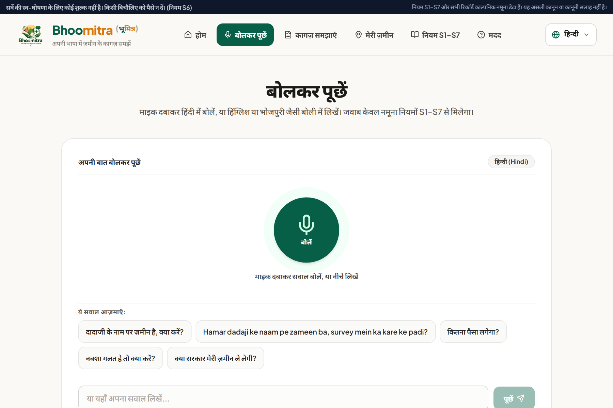
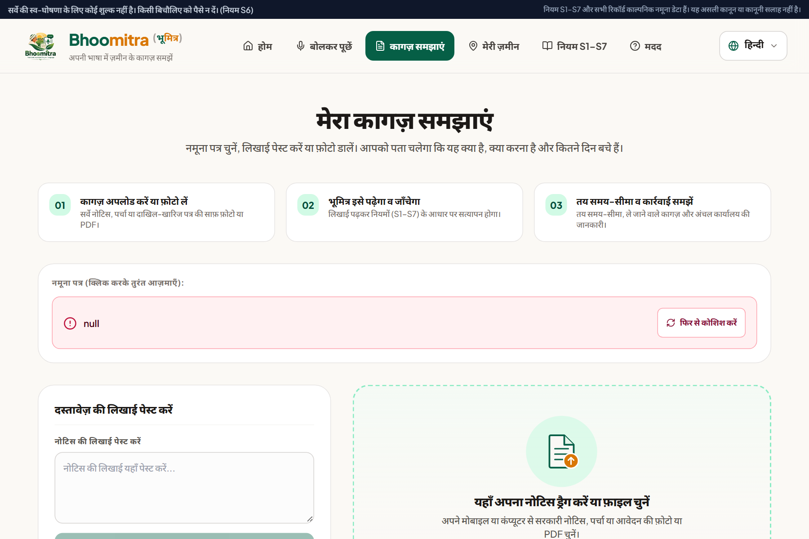
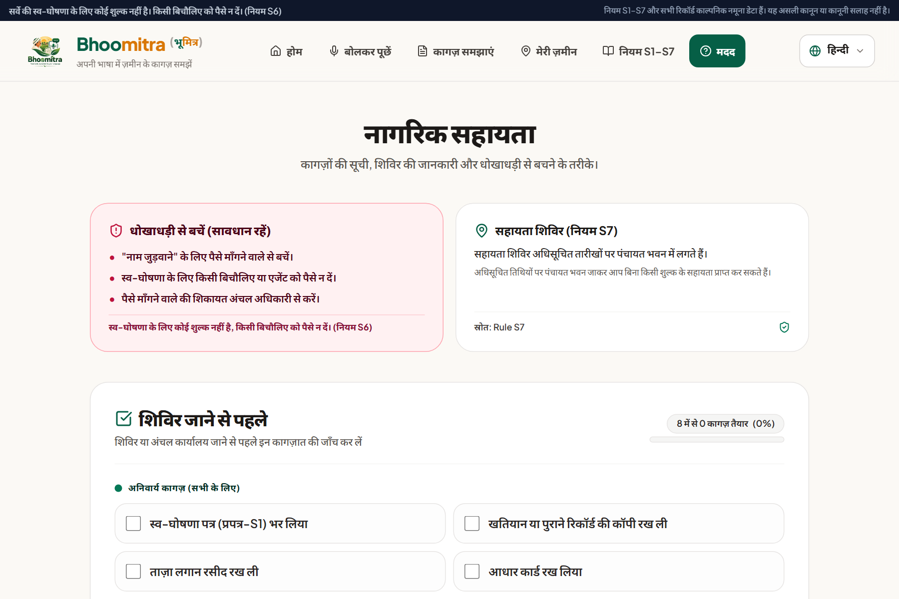
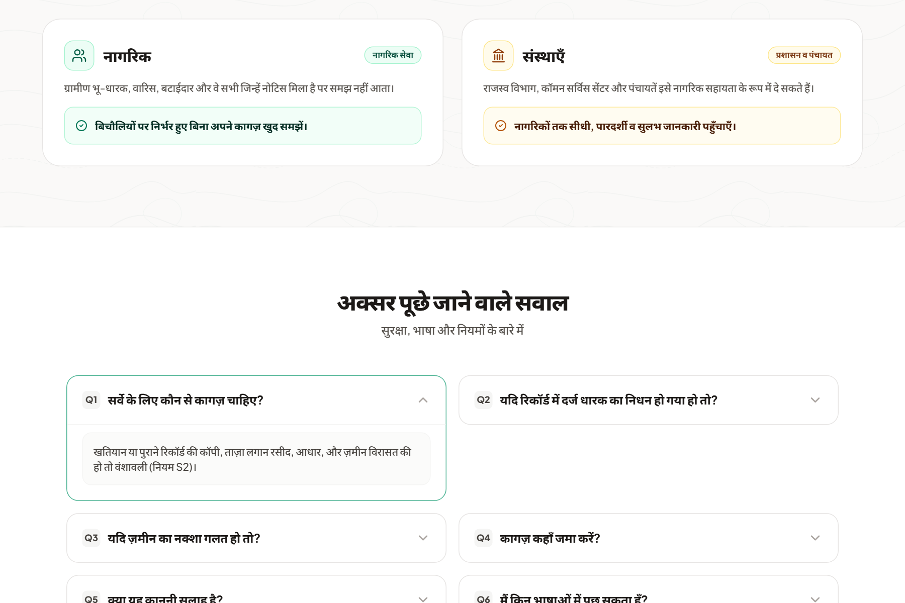

<p align="center">
  
</p>

<h1 align="center">Bhoomitra (भूमित्र)</h1>

<p align="center">
  <strong>Your land, explained in your language.</strong><br>
  <em>A voice-first civic AI assistant helping rural citizens understand land records, survey notices, and statutory deadlines in Bihar.</em>
</p>

<p align="center">
  <a href="https://python.org"></a>
  <a href="https://fastapi.tiangolo.com"></a>
  <a href="https://react.dev"></a>
  <a href="https://vitejs.dev"></a>
  <a href="https://tailwindcss.com"></a>
  <a href="https://ai.google.dev"></a>
  <a href="backend/tests"></a>
  <a href="LICENSE"></a>
</p>

**Bhoomitra** is a voice-first, grounded civic-tech platform that empowers rural citizens and farming families in Bihar to understand land survey notices, mutation orders, and khesra land records in **Hindi, Bhojpuri, Magahi, and English**.

Built on a zero-hallucination architecture, Bhoomitra pairs Google Gemini AI vision with a deterministic statutory rule engine. It provides plain-language answers, calculates precise legal countdown deadlines, identifies exact circle office submission counters, and protects citizens from middleman fraud.

---

## 📸 Platform Highlights

### 1. Multilingual Voice Q&A (`बोलकर पूछें`)
Citizens can speak naturally in Hindi, Bhojpuri, Magahi, or English. The interface provides real-time soundwave visualization, live recognized transcription, synchronous word-by-word read-aloud (*karaoke speech follow*), and actionable next steps.

<p align="center">
  
</p>

---

### 2. Explain My Paper (`कागज़ समझाएँ`)
Drop or photograph any official revenue notice, mutation order, or survey slip. The platform performs OCR analysis, identifies document kind, extracts case numbers, highlights statutory deadlines with days remaining, generates a checklist of required supporting documents, and specifies the exact camp counter to visit.

<p align="center">
  
</p>

---

### 3. Citizen Guidance & Interactive Self-Declaration Checklists (`नागरिक सहायता`)
Step-by-step guidance for Form Prapatra-2 (Self-Declaration), inheritance claims (*Vanshavali*), boundary dispute resolution, and statutory fee alerts (*Rule S6: Survey self-declaration is completely free*).

<p align="center">
  
</p>

---

### 4. Interactive FAQs & Legal Glossary
Comprehensive, searchable answers covering safety, survey camps, dispute escalation, and bilingual revenue terminology.

<p align="center">
  
</p>

---

## 🏛️ Core Capabilities

| Module | What the Citizen Gets |
| :--- | :--- |
| **Ask Bhoomitra** | Spoken or typed question &rarr; clear explanation in the chosen language citing verified statutory rules, with honest fallback when rules don't cover it. |
| **Explain My Document** | Upload photo or PDF &rarr; document identity, purpose, statutory deadline countdown, checklist of papers to bring, and circle office location. |
| **Land Record Explorer** | District, mauza, and khata search &rarr; plot and khesra details translated into plain language with pending action alerts. |
| **Citizen Help Desk** | Interactive camp preparation checklists, vanshavali guidance, no-fee statutory fraud warnings, FAQs, and revenue glossary. |

---

## 🧠 Architectural Philosophy: *"Code Does the Facts, AI Does the Explaining"*

Bhoomitra addresses the most dangerous problem in civic AI: **hallucinated legal advice**. 

To protect citizens, Bhoomitra enforces a strict two-tier architecture:

```
                  ┌──────────────────────────────────────────────┐
                  │              CITIZEN INTERACTION             │
                  │   Voice Input (Hindi / Bhojpuri / Magahi)    │
                  │        Document Camera Scan / Upload         │
                  └──────────────────────┬───────────────────────┘
                                         │
                                         ▼
                  ┌──────────────────────────────────────────────┐
                  │              FASTAPI API GATEWAY             │
                  │   Pydantic Validation & Input Sanitization   │
                  └──────────────────────┬───────────────────────┘
                                         │
                   ┌─────────────────────┴─────────────────────┐
                   │                                           │
                   ▼                                           ▼
       ┌───────────────────────┐                   ┌───────────────────────┐
       │     DETERMINISTIC     │                   │      GEMINI AI        │
       │   STATUTORY ENGINE    │                   │   VISION & SPEECH     │
       ├───────────────────────┤                   ├───────────────────────┤
       │ • Calendar date math  │                   │ • Audio transcription │
       │ • Days remaining calc │                   │ • Vision OCR extract  │
       │ • Strict Rule S1-S7   │                   │ • Plain language exp  │
       │ • Zero-fee guardrails │                   │ • Dialect translation │
       └───────────┬───────────┘                   └───────────┬───────────┘
                   │                                           │
                   └─────────────────────┬─────────────────────┘
                                         │
                                         ▼
                  ┌──────────────────────────────────────────────┐
                  │           SAFETY & CITATION AUDIT            │
                  │ • All cited rules must exist in database     │
                  │ • Dates & numbers cross-verified with rules  │
                  │ • Unverified claims routed to offline engine │
                  └──────────────────────┬───────────────────────┘
                                         │
                                         ▼
                  ┌──────────────────────────────────────────────┐
                  │        RESPONSIVE REACT 18 FRONTEND          │
                  │ Synchronized SpeechFollow + Civic Action Bar │
                  └──────────────────────────────────────────────┘
```

1. **Math and dates are handled by Python, not LLMs**: Deadlines, countdowns, and day offsets are calculated mathematically based on statutory rules.
2. **Every rule cited must exist**: If the AI cites a rule number not in the verified statutory database, the response is discarded and re-routed.
3. **Multi-Model Quota Resilience**: Uses an adaptive fallback cascade across Gemini Flash, Gemini Flash-Lite, and deterministic offline rule engines, ensuring 100% uptime even if API quotas or network outages occur.
4. **Anti-Fraud & Privacy-First**: Prominently warns citizens that self-declarations are free under Rule S6, and never stores or logs private citizen identification.

---

## 🌐 Voice & Multilingual Architecture

- **Speech Recognition:**
  - **Hindi & English:** Browser Web Speech API (`hi-IN`, `en-IN`) with seamless fallback to Gemini Audio.
  - **Bhojpuri & Magahi:** Captured via MediaRecorder, processed by Gemini Multimodal Audio to detect dialect, transcribe, and normalize queries.
- **Voice Synthesis:**
  - Dynamic cascade: Google TTS (gTTS) &rarr; Gemini Speech &rarr; Local OS SpeechSynthesis.
  - Synchronous visual follow-along highlights words on screen as they are spoken.

---

## 🛠️ Tech Stack

- **Backend:** Python 3.11+, FastAPI, Pydantic v2, Uvicorn, PyTest
- **Frontend:** React 18, Vite, Tailwind CSS, Lucide Icons, Canvas Confetti
- **AI & Vision:** Google Gemini 1.5/2.0 API (`google-genai` SDK), PIL, PyPDF
- **Audio & Speech:** Web Speech API, MediaStream Recording API, gTTS

---

## 🚀 Quickstart & Installation

### Prerequisites
- Python 3.11 or higher
- Node.js 18 or higher
- Google Gemini API Key ([Get a free key here](https://aistudio.google.com/))

### 1. Clone the Repository
```bash
git clone https://github.com/raj-vardhan-38/Bhoomitra.git
cd Bhoomitra
```

### 2. Backend Setup
```bash
cd backend

# Create virtual environment
python -m venv .venv

# Activate virtual environment
# Windows:
.venv\Scripts\activate
# Linux/macOS:
# source .venv/bin/activate

# Install dependencies
pip install -r requirements.txt

# Configure environment
copy .env.example .env    # On Linux/macOS use: cp .env.example .env
```

Open `backend/.env` and add your Gemini API key:
```ini
GEMINI_API_KEY="your-gemini-api-key-here"
```

Start the backend server:
```bash
uvicorn app.main:app --reload --port 8000
```
- Interactive API Swagger Docs: `http://localhost:8000/docs`

### 3. Frontend Setup
In a new terminal:
```bash
cd frontend

# Install packages
npm install

# Start development server
npm run dev
```

Open `http://localhost:5173` in Google Chrome or Microsoft Edge (recommended for Web Speech API support).

---

## 🧪 Testing

The platform includes a test suite covering document OCR extraction, dialect translation, date calculation, statutory rule citations, and security guardrails:

```bash
cd backend
.venv\Scripts\python -m pytest tests -q
```

**Result:** `183 passed in 2.6s`

---

## 👤 Author & Maintainer

**Raj Vardhan**  
*Lead Developer & AI Architect*  
GitHub: [@raj-vardhan-38](https://github.com/raj-vardhan-38)

---

## 📄 License

This project is licensed under the [MIT License](LICENSE).
